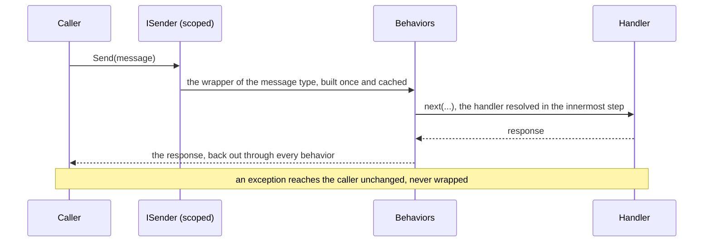

# Commands and queries

A command changes state and returns nothing (`ICommand`) or a light result such as an id (`ICommand<TResponse>`); a
query reads state (`IQuery<TResponse>`). Both are sent through `ISender.Send`, through the pipeline of behaviors, to
their handler: `ICommandHandler<TCommand>`, `ICommandHandler<TCommand, TResponse>` or
`IQueryHandler<TQuery, TResponse>`.



- **One handler per message.** A message implements exactly one of `ICommand`, `ICommand<TResponse>` and
  `IQuery<TResponse>`, and has exactly one handler. One class may handle several messages.
- **Checked at start-up.** Messages without a handler, messages with two handlers or two contracts, behaviors
  registered as the interface (`services.AddTransient(typeof(IPipelineBehavior<,>), ...)`), domain event handlers
  that can never run (of an interface or abstract event type) and mistakes of the
  [outbox configuration](08-integration-events.md#configuration-errors) are reported together in one
  `OptionsValidationException` when the host starts; without a host, when `ISender` is first resolved.
- **Scanning.** `AddHandlersFromAssemblies` / `AddHandlersFromAssemblyContaining<T>` add the handlers of the given
  assemblies, `internal` ones too, as transient, so they may depend on a `DbContext`; a handler with another lifetime
  is registered by hand before `AddPheme`, and the scan keeps it. `AddHandlersFromAssemblyContaining(typeof(...))`
  takes marker types that cannot be type arguments, such as a static module class. The start-up check covers the
  messages and integration events of these assemblies only, so add an assembly of contracts too, even without
  handlers: a message of an assembly not added fails only when it is sent, an integration event when it is written.
  Extensions such as `AddFluentValidation` search the same assemblies, so validators live next to the handlers. Pass
  the assemblies explicitly: `AppDomain.CurrentDomain.GetAssemblies()` returns only the assemblies loaded so far, and
  in tests also the test assemblies.
- **Modules.** `AddPheme` may be called several times; each assembly is registered once and the behaviors of all
  calls form one pipeline, in call order. In a modular monolith each module registers its own handlers in its
  infrastructure, and the composition root adds the pipeline, the outbox and the contracts the modules share, so it
  never lists the modules' assemblies:

  ```csharp
  // Ordering.Infrastructure, in the module's registration (AddOrdering)
  services.AddPheme(pheme => pheme.AddHandlersFromAssemblyContaining<OrderingModule>());

  // Shop.Api: the modules, then the pipeline
  builder.Services.AddOrdering(connectionString);
  builder.Services.AddShipping(connectionString);
  builder.Services.AddPheme(options => options
      .AddHandlersFromAssemblyContaining<OrderPlacedIntegrationEvent>()   // the contracts
      .AddOutbox()
      .AddRequestLogging()
      .AddFluentValidation());   // also the validators of the modules' assemblies
  ```

  Keep the behaviors and the outbox in the composition root: a behavior added by a module wraps the messages of every
  module. A module left out of the composition root fails the start for each message and integration event of the
  contracts only it handled.
- **Scopes.** `ISender` is scoped and resolves handlers from its own scope, so handlers may depend on a `DbContext`.
  Code outside a request, such as a hosted service, creates a scope first; a singleton depending on `ISender` fails
  scope validation instead of silently using the root provider.
- **Exceptions** of handlers and behaviors reach the caller unchanged, never wrapped.

---

Previous: [Getting started](02-getting-started.md) · [Contents](../README.md) · Next: [Pipeline behaviors](04-pipeline-behaviors.md)
