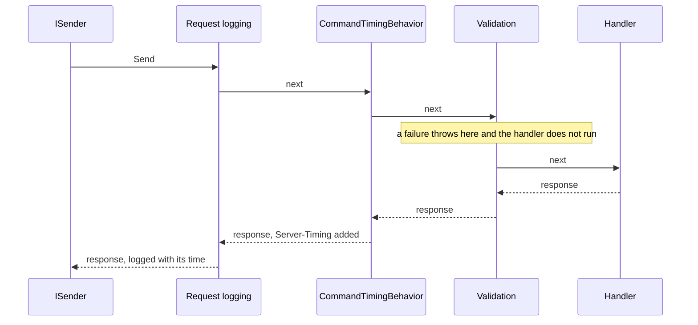

# Pipeline behaviors

A behavior wraps the handling of every message it applies to: the application's own cross-cutting code, such as
authorization, transactions or auditing. Pheme ships two ready-made ones,
[validation](05-validation.md) and [request logging](06-request-logging.md); anything else is a behavior the
application writes and adds with `AddBehavior`. The recipes - [transactions](../recipes/transactions.md),
[authorization](../recipes/authorization.md), [caching queries](../recipes/caching-queries.md),
[idempotent commands](../recipes/idempotent-commands.md) and [an audit trail](../recipes/audit-trail.md) - each have
a use case in the example application.

- **Which messages:** generic constraints choose them: `where TMessage : ICommand` for commands without a response,
  `ICommand<TResponse>` for commands with one, `IQuery<TResponse>` for queries, `IMessage` for all, or an interface of
  the application that the chosen messages implement, as in the recipes. Inside the pipeline a command without a
  response has `TResponse = Unit`.
- **Not events:** behaviors wrap only commands and queries sent through `ISender`. Domain event handlers run inside
  the save, so the behaviors of the command that saves - a transaction, request logging - wrap them too; integration
  event handlers are called by the outbox processor, outside any pipeline.
- **Registration:** pass the open generic type; Pheme closes it for every message its constraints accept.
- **Order:** behaviors run in the order they were added, the first one outermost. Request logging is always outermost.
- **Dependencies:** behaviors are resolved from the caller's scope, so they may take scoped services such as a
  `DbContext` or `IHttpContextAccessor`.
- **Calling `next` again**, for example to retry, runs the same instances of the inner behaviors and resolves the
  handler anew, a new instance of a transient handler, from the same scope: a scoped `DbContext` still holds what the
  failed call left in it.

## Example: timing commands

The example application adds the time of every command to the
response as a `Server-Timing` header, which the browser's developer tools show
([`Behaviors`](https://github.com/dawid1103/Pheme/tree/master/examples/ModularMonolith/Shop.Api/Behaviors)). This is
the application's code, not a Pheme feature: it shows a behavior limited to commands. Commands without and with a
response are separate contracts, so the behavior is two small classes sharing one implementation:

```csharp
// Commands without a response: TResponse is Unit inside the pipeline.
internal sealed class CommandTimingBehavior<TCommand>(IHttpContextAccessor httpContextAccessor)
    : IPipelineBehavior<TCommand, Unit>
    where TCommand : ICommand
{
    public Task<Unit> Handle(TCommand message, MessageHandlerDelegate<Unit> next, CancellationToken cancellationToken) =>
        CommandTiming.Measure(httpContextAccessor, typeof(TCommand), next, cancellationToken);
}

// Commands with a response, such as PlaceOrderCommand returning the new order's id.
internal sealed class CommandTimingBehavior<TCommand, TResponse>(IHttpContextAccessor httpContextAccessor)
    : IPipelineBehavior<TCommand, TResponse>
    where TCommand : ICommand<TResponse>
{
    public Task<TResponse> Handle(TCommand message, MessageHandlerDelegate<TResponse> next, CancellationToken cancellationToken) =>
        CommandTiming.Measure(httpContextAccessor, typeof(TCommand), next, cancellationToken);
}

internal static class CommandTiming
{
    public static async Task<TResponse> Measure<TResponse>(
        IHttpContextAccessor httpContextAccessor, Type commandType, MessageHandlerDelegate<TResponse> next, CancellationToken cancellationToken)
    {
        long started = Stopwatch.GetTimestamp();
        TResponse response = await next(cancellationToken);

        HttpResponse? httpResponse = httpContextAccessor.HttpContext?.Response;
        if (httpResponse is { HasStarted: false })
        {
            string duration = Stopwatch.GetElapsedTime(started).TotalMilliseconds.ToString("0.0", CultureInfo.InvariantCulture);
            httpResponse.Headers.Append("Server-Timing", $"command;desc=\"{commandType.Name}\";dur={duration}");
        }

        return response;
    }
}
```

Both classes are registered; queries match neither and are not timed:

```csharp
options.AddRequestLogging(...);                           // always outermost
options.AddBehavior(typeof(CommandTimingBehavior<>));     // commands without a response
options.AddBehavior(typeof(CommandTimingBehavior<,>));    // commands with a response
options.AddFluentValidation(...);                         // inside the timing, so the time includes validation
```

A command then goes in through the behaviors in the order they were added and comes back out the other way; the code
before `await next(...)` runs on the way in, the code after it on the way out:



A response of `POST /orders` then carries `Server-Timing: command;desc="PlaceOrderCommand";dur=12.3`. A failed
command throws before the header is added, so only successful commands are timed.

`AddBehavior` is ordinary code, so a behavior can be added conditionally. `Server-Timing` shows internal timings to
every client, so an application would usually add it in development only:

```csharp
if (builder.Environment.IsDevelopment())
{
    options.AddBehavior(typeof(CommandTimingBehavior<>));
    options.AddBehavior(typeof(CommandTimingBehavior<,>));
}
```

Pheme itself measures every message without a behavior: `ElapsedMs` in [request logging](06-request-logging.md) and the
`pheme.message.duration` metric in [tracing and metrics](12-tracing-and-metrics.md).

---

Previous: [Commands and queries](03-commands-and-queries.md) · [Contents](../README.md) · Next: [Validation](05-validation.md)
