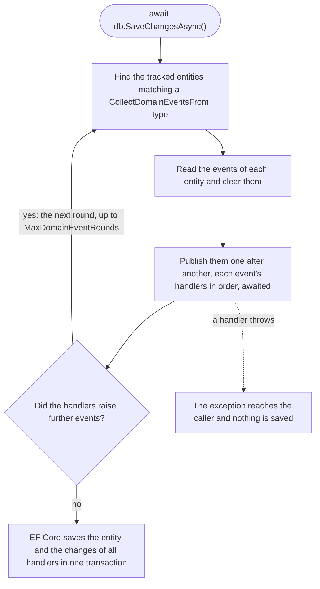

# Domain events

Domain events are the application's own types: Pheme needs no marker interface, so the domain does not reference
Pheme. Handlers implement `IDomainEventHandler<TEvent>` and are found by `AddPheme` like the other handlers. An event
may have any number of handlers, and one class may handle several events
([`RecordOrderHistoryDomainEventHandler.cs`](https://github.com/dawid1103/Pheme/blob/master/examples/ModularMonolith/Ordering.Application/Orders/History/RecordOrderHistoryDomainEventHandler.cs)):

```csharp
internal sealed class RecordOrderHistoryDomainEventHandler(IOrderingDbContext db)
    : IDomainEventHandler<OrderPlacedDomainEvent>,
      IDomainEventHandler<OrderCancelledDomainEvent>,
      IDomainEventHandler<OrderShippedDomainEvent>
{
    public Task Handle(OrderPlacedDomainEvent domainEvent, CancellationToken cancellationToken) =>
        db.Record(domainEvent.OrderId, $"Placed {domainEvent.Quantity} x {domainEvent.Product}", cancellationToken);

    public Task Handle(OrderCancelledDomainEvent domainEvent, CancellationToken cancellationToken) =>
        db.Record(domainEvent.OrderId, "Cancelled", cancellationToken);

    public Task Handle(OrderShippedDomainEvent domainEvent, CancellationToken cancellationToken) =>
        db.Record(domainEvent.OrderId, "Shipped", cancellationToken);
}
```

**Effects after the commit.** A domain event handler runs before the save, which may still fail, so it changes only
what the save stores. An e-mail, a call to another system or any other effect that cannot be taken back belongs to the
handler of an integration event, delivered by the [outbox](08-integration-events.md) once the change is
committed - within one module too. In the example, the order confirmation goes to the customer this way
([`SendOrderConfirmationIntegrationEventHandler.cs`](https://github.com/dawid1103/Pheme/blob/master/examples/ModularMonolith/Ordering.Application/Orders/Confirmation/SendOrderConfirmationIntegrationEventHandler.cs)).

## Publishing on save

`Pheme.EntityFrameworkCore` publishes the events of the tracked entities when a `DbContext` saves, so a command
handler only changes entities and calls `SaveChangesAsync`.

**1. The entities collect their events.** How is up to the application: an interface or a base class of its own
domain, without Pheme. The shipping module of the example uses a base class
([`AggregateRoot.cs`](https://github.com/dawid1103/Pheme/blob/master/examples/ModularMonolith/Shipping/Domain/AggregateRoot.cs)):

```csharp
public abstract class AggregateRoot
{
    private readonly List<IDomainEvent> domainEvents = [];

    public IReadOnlyList<IDomainEvent> DomainEvents => domainEvents.AsReadOnly();

    public void ClearDomainEvents() => domainEvents.Clear();

    protected void Raise(IDomainEvent domainEvent) => domainEvents.Add(domainEvent);
}

public sealed class Shipment : AggregateRoot
{
    public void Cancel()
    {
        Status = ShipmentStatus.Cancelled;
        Raise(new ShipmentPreparationCancelledDomainEvent(Id, OrderId));
    }
}
```

The ordering module implements an interface instead, `IHasDomainEvents`
([`Order.cs`](https://github.com/dawid1103/Pheme/blob/master/examples/ModularMonolith/Ordering.Domain/Orders/Order.cs)).
Map the events out of the model, for example `entity.Ignore(e => e.DomainEvents)`.

**2. Choose the `DbContext` that publishes, and tell Pheme how to read the events**
([`ShippingServiceCollectionExtensions.cs`](https://github.com/dawid1103/Pheme/blob/master/examples/ModularMonolith/Shipping/Infrastructure/ShippingServiceCollectionExtensions.cs)):

```csharp
services.AddPhemeDbContext<ShippingDbContext>(pheme =>
    pheme.CollectDomainEventsFrom<AggregateRoot>(
        entity => entity.DomainEvents,          // the events not published yet, in order
        entity => entity.ClearDomainEvents())); // forgets them, right before they are published

services.AddDbContext<ShippingDbContext>(options => options.UseNpgsql(connectionString));
```

One call per `DbContext` does everything: it registers the services and, for a context that collects events, adds the
interceptor to that context's options through EF Core's `ConfigureDbContext`, so `AddDbContext` stays as it is and may
come before or after it. A `DbContext` without the call, for example one for reports, publishes nothing.

| Setting | Meaning |
|---|---|
| `AddPhemeDbContext<TContext>(...)` | The `DbContext` Pheme works with: it publishes the events of its entities. It does not register the context (that is `AddDbContext`). Each context has its own configuration; calling it again for the same context adds to it. |
| `CollectDomainEventsFrom<TEntity>(get, clear)` | The application's contract of entities raising events: an interface or a base class. Every entity tracked by this context and assignable to `TEntity` is read with `get` and cleared with `clear`. The same `TEntity` again replaces its delegates; an entity matching two registered types throws, and so does each save of the context when no entity type of its model is assignable to `TEntity` (for example another module's interface). |
| `MaxDomainEventRounds` | How many rounds one save may run, default 10. More rounds mean handlers raise each other's events in a cycle: `InvalidOperationException`. |

**3. Handlers react in the same save**
([`NotifyWarehouseDomainEventHandler.cs`](https://github.com/dawid1103/Pheme/blob/master/examples/ModularMonolith/Shipping/Application/NotifyWarehouse/NotifyWarehouseDomainEventHandler.cs)):

```csharp
internal sealed class NotifyWarehouseDomainEventHandler(ShippingDbContext db)
    : IDomainEventHandler<ShipmentPreparationCancelledDomainEvent>
{
    public Task Handle(ShipmentPreparationCancelledDomainEvent domainEvent, CancellationToken cancellationToken)
    {
        // Not saved here: the notice is saved with the cancelled shipment, by the SaveChangesAsync that published
        // the event, in the same transaction.
        db.WarehouseNotices.Add(WarehouseNotice.Create(domainEvent.ShipmentId, "..."));
        return Task.CompletedTask;
    }
}
```

What `await db.SaveChangesAsync()` does, before Entity Framework Core writes anything:

1. Finds the tracked entities matching a `CollectDomainEventsFrom` type, in the order of `ChangeTracker.Entries()`.
2. Reads the events of each entity and clears them from it.
3. Publishes them one after another; each event's handlers run one after another, each awaited.
4. If the handlers raised further events, publishes those in the next round, up to `MaxDomainEventRounds`.
5. Saves the changes of the entity and of all handlers, in one call and one transaction.



A handler that throws stops the rest, and the exception reaches the caller: nothing is saved. In the example, an order
for more items than in stock answers 422 and saves neither the order nor what the earlier handlers changed
([`AllocateStockDomainEventHandler.cs`](https://github.com/dawid1103/Pheme/blob/master/examples/ModularMonolith/Ordering.Application/Inventory/AllocateStockDomainEventHandler.cs)).

**One transaction covers one `DbContext`.** A handler's changes are saved with the event only when it changes the
same `DbContext` instance, the module's scoped one. A handler that changes another module's `DbContext`, or sends a
command that saves it, writes in a separate transaction: if the first save fails afterwards, the two modules are out
of step. Between modules, use [integration events with an outbox](08-integration-events.md): in the example,
a cancelled order writes `OrderCancelledIntegrationEvent` with the order, and the shipping module cancels the shipment
when it is delivered
([`CancelOrder`](https://github.com/dawid1103/Pheme/tree/master/examples/ModularMonolith/Ordering.Application/Orders/CancelOrder),
[`CancelShipment`](https://github.com/dawid1103/Pheme/tree/master/examples/ModularMonolith/Shipping/Application/CancelShipment)).

Also:

- A handler must not save the `DbContext` that publishes its event, itself or through a command it sends: the save
  that publishes already saves the handler's changes, and a save from inside it would commit what has been changed so
  far in a transaction of its own, which a later handler's exception no longer rolls back. Such a save throws
  `InvalidOperationException`. Another `DbContext`, also another instance of the same type, saves as usual.
- A synchronous `SaveChanges` with events pending throws; without events it saves (seeding, data migrations).
- Pheme only publishes: what the save throws reaches the caller unchanged. Mapping it is the application's job; the
  example answers 409 for a save that conflicts with another request - a row version that no longer matches
  (`DbUpdateConcurrencyException`) or a unique index another save filled first
  ([`ApiExceptionFilter.cs`](https://github.com/dawid1103/Pheme/blob/master/examples/ModularMonolith/Shop.Api/Errors/ApiExceptionFilter.cs)).
  Handlers read what they change before the save's transaction starts - domain event handlers too, as they run before
  the save writes - so give the entities that concurrent requests change a concurrency token, or two orders may both
  allocate the last items of a stock: with PostgreSQL, a `uint` property or shadow property with `IsRowVersion()` maps
  to the system column `xmin`
  ([`OrderingDbContext.cs`](https://github.com/dawid1103/Pheme/blob/master/examples/ModularMonolith/Ordering.Infrastructure/OrderingDbContext.cs)).
- **What one save makes atomic.** Without a transaction of the application, EF Core opens the save's transaction after
  the handlers ran: only what they change through the context is saved atomically with the entity, and what they read
  is not isolated. `ExecuteUpdate`, `ExecuteDelete` and SQL, in a handler or a command handler, write at once, outside
  the save, and stay written when a later handler or the save fails. For those, and for reads that need isolation, the
  command runs in a transaction it opens itself - a [transaction behavior](../recipes/transactions.md) does it for chosen commands -
  and the save and its handlers run inside it. Changes tracked by the context need no such transaction. EF Core's
  retries (`EnableRetryOnFailure`) repeat the writing inside the save, after the handlers, not the handlers.
- The interceptor belongs to the scope the `DbContext` is created in, so it needs the default scoped options of
  `AddDbContext`. Options built outside a scope would publish through the root service provider, so a context that
  collects events fails the start when its `DbContextOptions<TContext>` or `IDbContextFactory<TContext>` is not
  scoped: `AddDbContextPool`, `AddPooledDbContextFactory`, `AddDbContextFactory` without `ServiceLifetime.Scoped` (it
  is singleton by default, also next to `AddDbContext`), or another `optionsLifetime` of `AddDbContext`. Without a
  host, which validates on start, the options fail when they are built.
- Without Entity Framework Core, call `IDomainEventPublisher.Publish` where the changes are saved.

## Dispatch rules

The rules are chosen to be predictable rather than clever:

- **Exact type.** An event reaches the handlers of its runtime type only, not those of a base type or an interface.
  A handler of an interface or abstract event type would never run, so the [start-up check](03-commands-and-queries.md)
  reports it. To handle every event of a kind, such as for auditing, write an open generic handler constrained to it and
  register it by hand; the container closes it for each event type that satisfies the constraint and skips it for the
  others:

  ```csharp
  internal sealed class AuditDomainEventHandler<TEvent>(AuditLog log) : IDomainEventHandler<TEvent>
      where TEvent : IDomainEvent
  {
      public Task Handle(TEvent domainEvent, CancellationToken cancellationToken) =>
          log.Write(domainEvent, cancellationToken);
  }

  services.AddTransient(typeof(IDomainEventHandler<>), typeof(AuditDomainEventHandler<>));
  ```
- **In order.** Events one after another; the handlers of an event one after another, each awaited, in the order of
  their registrations: handlers registered by hand before `AddPheme` first, then the scanned ones in the order of
  their full type names. When the order matters, register them by hand
  ([`OrderingApplicationServiceCollectionExtensions.cs`](https://github.com/dawid1103/Pheme/blob/master/examples/ModularMonolith/Ordering.Application/OrderingApplicationServiceCollectionExtensions.cs)).
- **First exception stops.** The remaining handlers and events are skipped and the exception reaches the caller
  unchanged, so the save does not happen.

---

Previous: [Request logging](06-request-logging.md) · [Contents](../README.md) · Next: [Integration events and the outbox](08-integration-events.md)
