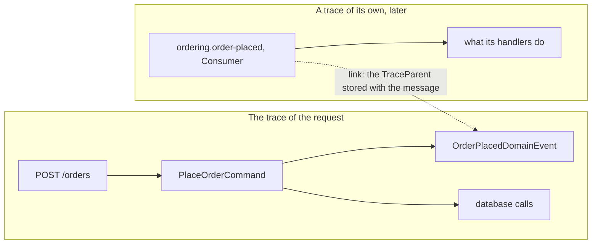

# Tracing and metrics

Every command, query, domain event and outbox delivery gets an activity (span) and a duration measurement, from the
`ActivitySource` and the `Meter` named `Pheme`. Nothing is recorded until something listens, for example OpenTelemetry:

```csharp
builder.Services.AddOpenTelemetry()
    .WithTracing(tracing => tracing.AddSource(PhemeDiagnostics.ActivitySourceName))
    .WithMetrics(metrics => metrics.AddMeter(PhemeDiagnostics.MeterName));
```

## In the example

The example adds the spans of the HTTP requests (`OpenTelemetry.Instrumentation.AspNetCore`) and of the database
calls (`Npgsql.OpenTelemetry`), and exports over OTLP when `OTEL_EXPORTER_OTLP_ENDPOINT` is set - to the Aspire
dashboard, Jaeger or an OpenTelemetry collector
([`Program.cs`](https://github.com/dawid1103/Pheme/blob/master/examples/ModularMonolith/Shop.Api/Program.cs)):

```csharp
IOpenTelemetryBuilder telemetry = builder.Services.AddOpenTelemetry()
    .ConfigureResource(resource => resource.AddService("Shop.Api"))
    .WithTracing(tracing => tracing
        .AddSource(PhemeDiagnostics.ActivitySourceName)
        .AddAspNetCoreInstrumentation()
        .AddNpgsql())
    .WithMetrics(metrics => metrics
        .AddMeter(PhemeDiagnostics.MeterName)
        .AddAspNetCoreInstrumentation());
if (!string.IsNullOrEmpty(builder.Configuration["OTEL_EXPORTER_OTLP_ENDPOINT"]))
{
    telemetry.UseOtlpExporter();
}
```

`POST /orders` then shows as one trace: the request, inside it the span of `PlaceOrderCommand`, inside that the span
of `OrderPlacedDomainEvent` and the database calls; the delivery of `ordering.order-placed` is a trace of its own,
linked to it. To try it locally, run the Aspire dashboard
(`docker run --rm -p 18888:18888 -p 4317:18889 mcr.microsoft.com/dotnet/aspire-dashboard`), start the example with
`OTEL_EXPORTER_OTLP_ENDPOINT=http://localhost:4317` and open the dashboard's address with the token it logs. A test
reads the same signals with the in-memory exporter (`OpenTelemetry.Exporter.InMemory`,
[`TelemetryTests.cs`](https://github.com/dawid1103/Pheme/blob/master/tests/Pheme.Examples.IntegrationTests/TelemetryTests.cs)):

```csharp
builder.ConfigureTestServices(services => services
    .ConfigureOpenTelemetryTracerProvider(tracing => tracing.AddInMemoryExporter(spans))
    .ConfigureOpenTelemetryMeterProvider(meters => meters.AddInMemoryExporter(metrics)));
```

## Signals

| Signal | Name | Tags |
|---|---|---|
| span | full type name of the message or event; stored name of an integration event | `pheme.message.type`, `pheme.message.kind`, `error.type` on failure; `pheme.outbox.source` on a delivery |
| histogram | `pheme.message.duration`, in seconds | `pheme.message.type`, `pheme.message.kind`, `error.type` on failure |
| gauge | `pheme.outbox.messages` | `pheme.outbox.source`, `pheme.outbox.message.state` (`pending`, `parked`) |
| gauge | `pheme.outbox.oldest_pending.age`, in seconds, 0 when none is pending | `pheme.outbox.source` |

The type names of messages and domain events are written as in C#, a nested type with a dot:
`Shop.PlaceOrder.Command`, `Ns.Handler<Ns.Order>`.
`pheme.message.kind` is `command`, `query`, `domain_event` or `integration_event`. A failure is any exception thrown to
the caller, or the failure of a delivery: `error.type` is the exception's full type name and the span status is
`Error`. The span covers the whole pipeline and the handler (for an event, all its handlers), and is the parent of
what they do, such as database calls. The span of an outbox delivery has the kind `Consumer`, starts its own trace and
links to the span that wrote the message. The outbox gauges read the stores only when they are collected. All names
are constants of `PhemeDiagnostics`.

## From a delivery back to the request

An outbox message is delivered after the request that wrote it has ended, often by another process, so the delivery
cannot be a child span of the request: one trace would grow with every retry. Instead the outbox stores the W3C trace
context of the writing activity with the message, in `OutboxMessage.TraceParent` (`00-<trace id>-<span id>-<flags>`),
and the delivery starts a trace of its own with a link to it. Tracing backends such as Jaeger, Tempo, Application
Insights and the Aspire dashboard show the link, so a slow or failing delivery leads to the request that caused it,
and the other way round.

In the example, the handler of `OrderPlacedDomainEvent` writes the message, so the delivery links to that span:



`TraceParent` is `null` when there was no current activity at the write, or when the current activity does not use the W3C id
format (`Activity.DefaultIdFormat` is W3C from .NET 5); the delivery then has no link. Pheme only stores it and links
to it. A custom `IOutboxStore` should keep the value with the message, and an application can read it from
`OutboxMessage` to pass the trace on, for example as a `traceparent` header to a broker.

---

Previous: [Testing](11-testing.md) · [Contents](../README.md) · Next: [Configuration](13-configuration.md)
